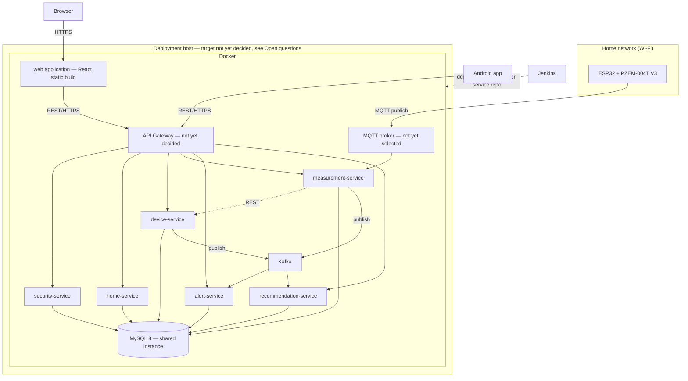

# Deployment

---

## Infrastructure diagram

> The Android app is not deployed to this infrastructure — it is distributed as an installable
> build (`01-context/overview.md`: React Native, Android only).

---

## What goes in Docker

Each microservice, the frontend static build, the shared MySQL instance, the MQTT broker, and
Kafka each run as their own container. `01-context/overview.md` (Technology stack) states Docker
plus Jenkins for reproducible environments and independent CI/CD per service — **Kubernetes is
not part of the stack**; there is no orchestrator beyond Docker itself.

| Container                                          | Image basis                                      | Notes                                                                                                                   |
| -------------------------------------------------- | ------------------------------------------------ | ----------------------------------------------------------------------------------------------------------------------- |
| `security-service` … `recommendation-service` (×6) | Java 21 + Spring Boot, one image per service     | Built and deployed independently, each from its own repository and Jenkins pipeline                                     |
| `mysql`                                            | MySQL 8                                          | Single shared instance — see `ADR-003-shared-database.md` (pending) and the access-boundary rule in `06-data/models.md` |
| MQTT broker                                        | Not yet selected                                 | See Open questions                                                                                                      |
| Kafka                                              | Apache Kafka                                     | See `ADR-002-domain-event-transport.md` (pending)                                                                       |
| `web`                                              | React + Vite production build, served statically | —                                                                                                                       |
| API Gateway                                        | Not yet decided                                  | See Open questions                                                                                                      |

A per-container resource sizing table is not included here — no minimum CPU/RAM/disk requirements
have been set for any container yet. This should be filled in once the deployment host is chosen
(see Open questions).

---

## Network configuration

- **Devices → backend:** the ESP32 units connect over the home's own Wi-Fi network and publish to
  the MQTT broker; the backend never initiates a connection to a device
  (`02-domain/domain-map.md`, relationships table).
- **Clients → backend:** the web and Android clients call the backend over REST/HTTPS. Whether
  that traffic goes through a single API Gateway or hits services directly is exactly the open
  gateway decision in `05-architecture/overview.md` — this document assumes a gateway exists, but
  that assumption is not yet a decision.
- **Inter-service:** REST calls and Kafka traffic stay inside the Docker network on the
  deployment host; no inter-service traffic is designed to cross the public internet.
- **Database access:** only the six microservices connect to MySQL; no client application or
  external component connects to it directly.
- Port numbers, TLS termination point, and firewall rules are **not yet defined** — see Open
  questions.

---

## Environments

Per `01-context/scope.md` ("Environments being built"):

| Environment         | Purpose                                                                                              | Notes                                                                                                               |
| ------------------- | ---------------------------------------------------------------------------------------------------- | ------------------------------------------------------------------------------------------------------------------- |
| Local               | Development on each developer's machine, including a locally connected or simulated measuring device | No shared infrastructure required                                                                                   |
| Development (`dev`) | Integration testing between services before merging to `main`                                        | Also absorbs the role a dedicated staging environment would normally play — not planned separately, given team size |
| Production          | The environment the finished project is evaluated and demonstrated in                                | Hosting target not yet decided — see Open questions                                                                 |

---

## Hardware requirements

### Measuring device (client-side hardware — part of the product, not server infrastructure)

| Component    | Role                                                                                                     |
| ------------ | -------------------------------------------------------------------------------------------------------- |
| ESP32        | Wi-Fi connectivity and processing; reports measurements autonomously                                     |
| PZEM-004T V3 | Measures real electrical magnitudes (voltage, current, active power, energy) rather than estimating them |
| HLK-PM03     | Powers the device from the same mains circuit it monitors                                                |

Source: `01-context/overview.md`, Technology stack. About COP $180,000 has already been invested
in these components (`01-context/scope.md`, Constraints — Budget).

### Server-side hardware

**Not yet defined.** `01-context/scope.md` states no budget is currently allocated for paid
hosting, cloud infrastructure, or other paid third-party services — which rules out most managed
cloud options but does not by itself answer where Production actually runs. See Open questions.

---

## Open questions

These are gaps found while writing this document, not decisions made here:

| Question                                                                                                   | Impact                                                                                                                                  |
| ---------------------------------------------------------------------------------------------------------- | --------------------------------------------------------------------------------------------------------------------------------------- |
| Where does Production actually run (a SENA-provided machine, a developer's own machine, a free-tier host)? | Determines the rest of this document's network configuration and hardware requirements sections                                         |
| Which MQTT broker?                                                                                         | Blocks finalizing the "What goes in Docker" and "Network configuration" sections; already flagged in `01-context/scope.md`, feature #11 |
| Which API Gateway, or none?                                                                                | Same as in `05-architecture/overview.md` — needs `ADR-004-api-gateway.md`                                                               |
| Container resource sizing (CPU/RAM/disk per service)                                                       | Cannot be set meaningfully before the hosting target is known                                                                           |
| TLS termination and port allocation                                                                        | Depends on the Gateway and hosting decisions above                                                                                      |

---

## Correlations

- Container-level architecture and communication patterns → `05-architecture/overview.md`
- Shared-database decision → `ADR-003-shared-database.md` (`05-architecture/decisions/records/`, pending)
- Kafka transport decision → `ADR-002-domain-event-transport.md` (`05-architecture/decisions/records/`, pending)
- Environments and constraints (budget, timeline, team) → `01-context/scope.md`
- Database migrations repository (Liquibase) → `06-data/migration-strategy.md`
