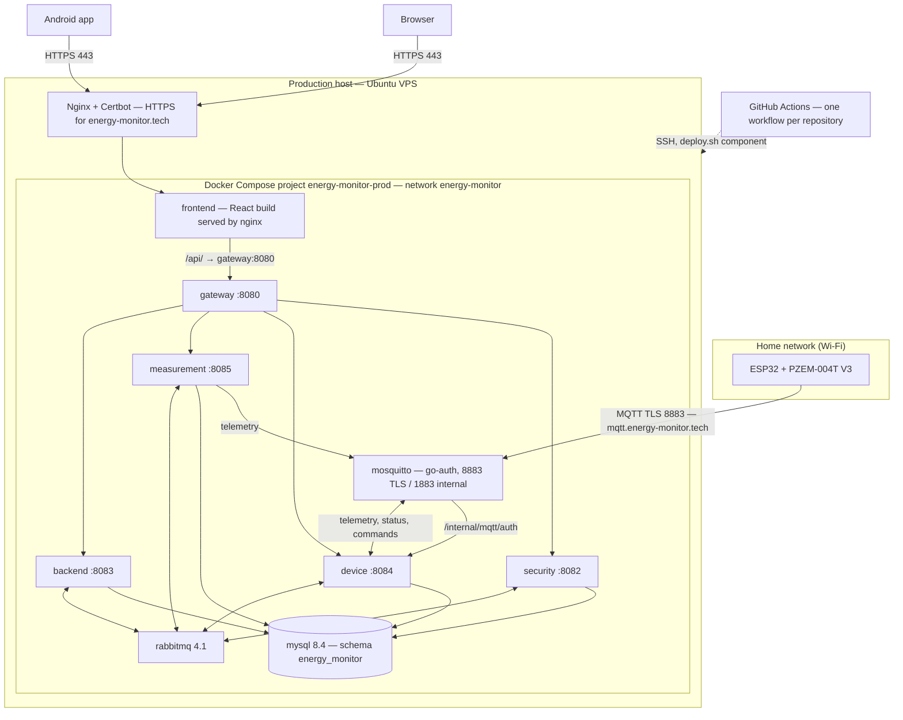

# Deployment

> State at 24-Oct-2026. Everything below runs in production at `https://energy-monitor.tech`.
> The Docker setup lives in the `energy-monitor-infra` repository; each code repository keeps
> its own `Dockerfile`, and infra builds the images from there.

---

## Infrastructure diagram

> The Android app is not deployed to this infrastructure: it is distributed as an installable
> build and calls the same public API.

---

## What goes in Docker

Every backend component, the web build, MySQL, RabbitMQ and Mosquitto run as containers of one
Compose project. There is no orchestrator beyond Docker Compose.

| Container | Image | Notes |
|---|---|---|
| `gateway` | `en-monitor-api-gateway` Dockerfile (multi-stage Maven + JRE 21, uid 10001) | Receives only `public.pem` |
| `security` | `en-monitor-security-service` Dockerfile | Reads `private.pem`, so it runs as `BACKEND_UID:BACKEND_GID` |
| `device` | `en-monitor-device-service` Dockerfile | Receives only `public.pem`; Mosquitto authenticates against it |
| `measurement` | `en-monitor-measurement-service` Dockerfile | Receives only `public.pem`; telemetry subscription on (`MEASUREMENT_MQTT_ENABLED=true`) |
| `backend` | `energy-monitor-backend` Dockerfile | Receives only `public.pem`; not an MQTT client |
| `frontend` | Web app Dockerfile (Vite build served by nginx) | Built with an empty `VITE_API_BASE_URL`: the browser calls `/api/v1/...` on its own origin and nginx forwards `/api/` to `gateway:8080`, so no CORS is needed |
| `mysql` | `mysql:8.4` | Shared schema (`ADR-003`), volume `mysql-data` |
| `rabbitmq` | `rabbitmq:4.1-management` | Events and mail requests (`ADR-008`), volume `rabbitmq-data` |
| `mosquitto` | `iegomez/mosquitto-go-auth:3.0.0-mosquitto_2.0.18` | MQTT broker (`ADR-007`); same `mosquitto.conf` in every mode |

The five Java containers have a `healthcheck` on `/actuator/health`; for the security service,
the device service and the backend it includes MySQL and RabbitMQ.

---

## Compose modes

| Mode | Files | Use |
|---|---|---|
| Full local stack | `docker-compose.yml` | The whole system on one PC (demo, end-to-end tests) |
| Development | `docker-compose.yml` + `docker-compose.dev.yml` | Only MySQL, RabbitMQ and Mosquitto in Docker; the services run on the PC with `./mvnw` |
| Production | `docker-compose.prod.yml` + `.env.prod` | The VPS, behind Nginx and Let's Encrypt |

Step-by-step local setup: `10-devops/local-setup.md`.

---

## Network configuration

- **Clients → backend:** the host's Nginx terminates HTTPS for the domain and forwards everything
  to the web container (`127.0.0.1:${WEB_PORT}`, 8081 by default). That container serves the web
  app and forwards `/api/` to the gateway. Neither the gateway nor the services publish a port.
- **Devices → broker:** the ESP32 modules connect to `mqtt.energy-monitor.tech:8883` over TLS
  (Let's Encrypt certificate, copied to the broker by `deploy/renew-mqtt-cert.sh` on renewal).
  The 1883 listener without TLS is used only inside the Docker network by the device and
  measurement services. The backend never initiates a connection to a device.
- **Inter-service:** internal REST (`/internal/**`) and AMQP stay inside the Docker network.
  `/internal/**` also requires `X-Internal-Token` (except Mosquitto's `/internal/mqtt/auth/**`,
  restricted by network only); the gateway and the web nginx never forward it. The gateway and the services take the caller's address from `X-Forwarded-For` only when the
  connection comes from loopback or the Docker network (`172.16.0.0/12`).
- **Firewall:** only 22, 80, 443 and 8883 are open. 1883, 3306, 5672, 8081 and 15672 are bound to
  `127.0.0.1` or not published; the RabbitMQ console is reached through an SSH tunnel.
- **Database access:** only the security, device and measurement services and the backend
  connect to MySQL.

---

## Release process (CI/CD)

- Every code repository (gateway, security, device, measurement, backend, web) and the infra
  repository has `.github/workflows/ci-cd.yml`.
- **CI** on every pull request and push to `dev` and `main`: `./mvnw test` (against a MySQL 8.4
  service of the runner where the service needs it), `vitest` + build for the web, and for infra
  `docker compose config` of the three modes, `shellcheck` and `nginx -t`.
- **CD** only from `main`, after the tests and the approval of the `production` environment: SSH
  to the VPS with a key restricted to `infra/deploy/deploy.sh
  backend|security|device|measurement|gateway|frontend|infra`. The script backs up MySQL, pulls
  `main`, rebuilds only that component, waits until the five Java services are `healthy` and the
  web answers, and rolls back only if that fails.
- Branches in every repository: `main` (production) and `dev` (integration); pull requests go to
  `dev`, and from `dev` to `main`.
- A daily logical MySQL backup runs from root's cron (`deploy/backup-mysql.sh`).

---

## Environments

| Environment | Purpose | Notes |
|---|---|---|
| Local | Development on each developer's machine, full stack or development mode | `energy-monitor-infra`, see `10-devops/local-setup.md` |
| Development (`dev` branch) | Integration of pull requests before `main` | CI only; there is no separate `dev` server |
| Production | `https://energy-monitor.tech` | Ubuntu VPS, deployed from `main` |

---

## Hardware requirements

### Measuring device (client-side hardware — part of the product, not server infrastructure)

| Component | Role |
|---|---|
| ESP32 | Wi-Fi connectivity and processing; reports measurements autonomously |
| PZEM-004T V3 | Measures real electrical magnitudes (voltage, current, active power, energy) rather than estimating them |
| HLK-PM03 | Powers the device from the same mains circuit it monitors |

Firmware 1.3.8; a module is linked over Bluetooth from the web or the mobile app. Source:
`01-context/overview.md`, Technology stack.

### Server-side hardware

One Ubuntu VPS. Its CPU, memory and disk sizing is not recorded in this repository.

---

## Open questions

| Question | Impact |
|---|---|
| Container resource limits (CPU/RAM per service) are not set | Capacity planning when the four remaining contexts become services |
| Deployment of the services that will come out of `energy-monitor-backend` (in progress) | New containers, routes and `deploy.sh` targets once they exist |

---

## Correlations

- Container-level architecture and communication → `05-architecture/overview.md`
- Shared database → `ADR-003-shared-database.md`
- Event transport → `ADR-008-rabbitmq-transactional-outbox.md`
- MQTT broker → `ADR-007-mqtt-broker-selection.md`
- Environments → `10-devops/environments.md`
- Local setup → `10-devops/local-setup.md`
- Migrations → `06-data/migration-strategy.md`, `ADR-009-liquibase-changelogs-per-service.md`
