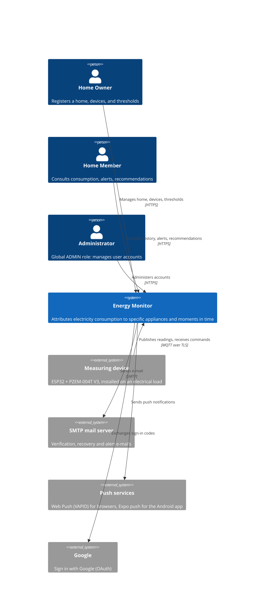

# System Architecture Overview

> **State at 28-Oct-2026, in production at `https://energy-monitor.tech`.** The backend started
> as one modular monolith with seven bounded contexts. The migration finished on 28-Oct-2026:
> every bounded context — Security, Devices, Monitoring/Measurements, Home Management,
> Notification, Alerts and Recommendations — runs as its own microservice behind an API
> gateway, and the monolith `energy-monitor-backend` was retired (it only keeps the ESP32
> firmware and its history).

---

## Architecture diagram

### C4 Level 1 — System Context

### C4 Level 2 — Containers

```mermaid
C4Container
    Person(user, "Home Owner / Home Member / Administrator")
    System_Ext(measuringDevice, "Measuring device", "ESP32 + PZEM-004T V3")

    Container_Boundary(clients, "Clients") {
        Container(webApp, "Web application", "React 19 + Vite 8, served by nginx", "Full-featured client")
        Container(androidApp, "Android application", "Expo 57 / React Native", "Daily consultation and alerts client")
    }

    Container(apiGateway, "en-monitor-api-gateway :8080", "Spring Cloud Gateway Server Web MVC", "Single API entry point: CORS, token check, rate limit, routing")

    Container_Boundary(services, "Backend — Java 21") {
        Container(security, "en-monitor-security-service :8082", "Spring Boot 4.1.1", "Accounts, login, JWT, sessions, RBAC, audit")
        Container(device, "en-monitor-device-service :8084", "Spring Boot 4.1.1", "Devices, credentials, broker auth/ACL, commands, connectivity")
        Container(measurement, "en-monitor-measurement-service :8085", "Spring Boot 4.1.1", "Readings, history, statistics, home consumption, levels")
        Container(home, "en-monitor-home-service :8086", "Spring Boot 4.1.1", "Homes, members, thresholds, ownership")
        Container(notification, "en-monitor-notification-service :8087", "Spring Boot 4.1.1", "E-mail, Web Push, mobile push, inbox")
        Container(alert, "en-monitor-alert-service :8088", "Spring Boot 4.1.1", "Threshold, unusual-consumption, limit and connectivity alerts")
        Container(recommendation, "en-monitor-recommendation-service :8089", "Spring Boot 4.1.1", "Hourly saving rules")
    }

    ContainerDb(mysql, "MySQL 8.4", "Schema energy_monitor", "One shared schema, each service owns its tables — ADR-003")
    ContainerQueue(rabbit, "RabbitMQ 4.1", "Topic exchanges", "Service-to-service events with transactional outbox — ADR-008")
    ContainerQueue(mqtt, "Mosquitto (go-auth)", "MQTT 8883 TLS / 1883 internal", "Device telemetry, status and commands — ADR-007")

    Rel(user, webApp, "Uses", "HTTPS")
    Rel(user, androidApp, "Uses")
    Rel(webApp, apiGateway, "/api/v1/**", "REST, same origin")
    Rel(androidApp, apiGateway, "/api/v1/**", "REST/HTTPS")

    Rel(apiGateway, security, "Routes")
    Rel(apiGateway, device, "Routes")
    Rel(apiGateway, measurement, "Routes")
    Rel(apiGateway, home, "Routes")
    Rel(apiGateway, notification, "Routes")
    Rel(apiGateway, alert, "Routes")
    Rel(apiGateway, recommendation, "Routes")

    Rel(measuringDevice, mqtt, "Telemetry, status / commands", "MQTT TLS 8883")
    Rel(mqtt, device, "Authenticates every client", "POST /internal/mqtt/auth/user, /acl")
    Rel(device, mqtt, "Reads telemetry and status, publishes commands")
    Rel(measurement, mqtt, "Reads telemetry")

    Rel(device, home, "Home access", "/internal/**")
    Rel(measurement, home, "Home access, thresholds", "/internal/**")
    Rel(alert, home, "Home access, thresholds", "/internal/**")
    Rel(recommendation, home, "Home access, thresholds", "/internal/**")
    Rel(notification, home, "Name and members", "/internal/**")
    Rel(home, security, "Member profiles", "/internal/**")
    Rel(security, home, "Account deletion check", "/internal/**")
    Rel(notification, security, "Profiles, permissions, administrators", "/internal/**")
    Rel(measurement, device, "Device reads", "/internal/**")
    Rel(alert, device, "Device reads", "/internal/**")
    Rel(recommendation, device, "Device reads", "/internal/**")
    Rel(notification, device, "Device reads", "/internal/**")
    Rel(alert, measurement, "Levels, hourly energy", "/internal/**")
    Rel(recommendation, measurement, "Hourly energy", "/internal/**")

    Rel(security, rabbit, "account.*, mail.*")
    Rel(home, rabbit, "home.*; consumes account.deleted")
    Rel(device, rabbit, "device.*; consumes home.deleted")
    Rel(measurement, rabbit, "measurement.recorded")
    Rel(alert, rabbit, "alert.raised; consumes measurement and device events")
    Rel(recommendation, rabbit, "recommendation.created")
    Rel(notification, rabbit, "Consumes account, mail, home, device, alert and recommendation events")

    Rel(security, mysql, "Its tables")
    Rel(device, mysql, "Its tables")
    Rel(measurement, mysql, "Its tables")
    Rel(home, mysql, "Its tables")
    Rel(notification, mysql, "Its tables")
    Rel(alert, mysql, "Its tables")
    Rel(recommendation, mysql, "Its tables")
```

> Both diagrams use the Mermaid `C4Context`/`C4Container` notation. If the renderer used to view
> this repository does not support the C4 extension, the same information is in the tables
> below.

---

## Microservices

| Component | Port | Responsibility | Technology | DB |
|---|---|---|---|---|
| `en-monitor-api-gateway` | 8080 | Single API entry point: CORS, access-token validation, `em_access` cookie to bearer token, rate limit of the public account `POST`s (20 per address and path per minute), routing, refusal of `/internal/**`, 503/504 answers | Java 21, Spring Boot 4.0.8, Spring Cloud Gateway Server Web MVC (Spring Cloud 2025.1.3) | None |
| `en-monitor-security-service` | 8082 | Accounts, registration with e-mail verification, login, Sign in with Google, JWT RS256 (15 min) + rotating refresh token, HttpOnly session cookies for the web, password recovery, profile, account deletion, RBAC and user administration, support contacts | Java 21, Spring Boot 4.1.1 | Shared MySQL — security tables |
| `en-monitor-device-service` | 8084 | Device linking, editing, credential reissue (API key stored as SHA-256 hash), unlinking, appliance catalogue, MQTT authentication and ACL, MQTT commands, connectivity (OFFLINE after 150 s without data) | Java 21, Spring Boot 4.1.1 | Shared MySQL — device tables |
| `en-monitor-measurement-service` | 8085 | The only subscriber that stores telemetry; history, latest reading, statistics, home consumption (summary and history), consumption levels; publishes `measurement.recorded`; internal API for the alert and recommendation services | Java 21, Spring Boot 4.1.1 | Shared MySQL — measurement tables |
| `en-monitor-home-service` | 8086 | Homes, access code, members, roles, favourites, thresholds (daily or monthly limit), deletion, ownership transfer; answers who may act on a home; publishes `home.*` | Java 21, Spring Boot 4.1.1 | Shared MySQL — home tables |
| `en-monitor-notification-service` | 8087 | Delivery of alerts, recommendations and activity by e-mail, Web Push and mobile push; the only service that sends e-mail (including the verification codes); preferences; in-app inbox; administrator notices | Java 21, Spring Boot 4.1.1 | Shared MySQL — notification tables |
| `en-monitor-alert-service` | 8088 | Threshold, unusual-consumption, limit, connectivity and linked-device alerts; inbox; publishes `alert.raised` | Java 21, Spring Boot 4.1.1 | Shared MySQL — alert tables |
| `en-monitor-recommendation-service` | 8089 | Five saving rules evaluated every hour; inbox; publishes `recommendation.created` | Java 21, Spring Boot 4.1.1 | Shared MySQL — recommendation tables |

Each component has its own repository, its own GitHub Actions workflow and its own Docker image
(see `05-architecture/deployment.md`). Inside each service the code follows hexagonal
architecture by module (`domain`, `application`, `adapter`, `infrastructure`, `api`); the
gateway has no domain and is organised by concern (`routing`, `security`, `ratelimit`, `error`)
— see `05-architecture/hexagonal-architecture.md`.

### Where each bounded context runs

| Bounded context | Runs in | Status |
|---|---|---|
| Security | `en-monitor-security-service` | Microservice, in production |
| Devices | `en-monitor-device-service` | Microservice, in production |
| Monitoring and Measurements | `en-monitor-measurement-service` | Microservice, in production |
| Home Management | `en-monitor-home-service` | Microservice, in production |
| Alerts | `en-monitor-alert-service` | Microservice, in production |
| Recommendations | `en-monitor-recommendation-service` | Microservice, in production |
| Notification | `en-monitor-notification-service` | Microservice, in production |

The two client applications are not microservices; both call the gateway, and the migration did
not change the public API paths they use:

| Client | Platform | Technology | Repository |
|---|---|---|---|
| Web application | Browser | React 19 + Vite 8 | `Energy-Monitor-application` |
| Mobile application | Android | Expo 57 / React Native | `Energy-Monitor-Mobile` |

---

## Communication patterns

- **Gateway:** every client request enters through `en-monitor-api-gateway` (`ADR-004`). Routes,
  most specific first:

  | Paths | Service |
  |---|---|
  | `/api/v1/auth/**`, `/api/v1/admin/users/**`, `/api/v1/admin/roles/**`, `/api/v1/support/**` | security :8082 |
  | `/api/v1/homes/{homeId}/devices/**`, `/api/v1/appliance-types/**` | device :8084 |
  | `/api/v1/measurements/**`, `/api/v1/consumption-levels/**`, `/api/v1/homes/{homeId}/consumption/**` | measurement :8085 |
  | the rest of `/api/v1/homes/**`, `/api/v1/home-types/**` | home :8086 |
  | `/api/v1/notifications/**`, `/api/v1/admin/notifications/**` | notification :8087 |
  | `/api/v1/alerts/**` | alert :8088 |
  | `/api/v1/recommendations/**` | recommendation :8089 |
  | `/internal/**` | never forwarded |

  The gateway validates the token (RS256, issuer, expiry) and each service validates it again
  and decides the permissions (`ADR-010`).

- **Sync (internal REST, `/internal/**`):** accepted only from loopback or the Docker network
  (`172.16.0.0/12`) **and** with the `X-Internal-Token` header (`INTERNAL_API_TOKEN`, the same
  value in every service), compared in constant time. The exception is
  `/internal/mqtt/auth/**`, called by Mosquitto, which is restricted to the allowed networks only.
  A user's access token does not open these routes.

  | Caller → callee | Endpoints | Purpose |
  |---|---|---|
  | home → security | `POST /internal/users/profiles` | Names (and photos) of the members of a home |
  | notification → security | `POST /internal/users/profiles`, `GET /internal/users/{id}/permissions`, `GET /internal/administrators` | Names and e-mails, `USER.READ`, administrators (cached) |
  | security → home | `GET /internal/accounts/{id}/deletion-check` | May the account be deleted? |
  | device, measurement, alert, recommendation → home | `GET /internal/homes/{homeId}/access?userId=` | Is the caller a member / the owner of the home? (never cached) |
  | measurement, alert, recommendation → home | `GET /internal/homes/{homeId}/thresholds` | Daily and monthly limits |
  | notification → home | `GET /internal/homes/{homeId}` | Name and members of a home |
  | measurement, alert, recommendation, notification → device | `GET /internal/devices/{id}`, `GET /internal/homes/{homeId}/devices` | Device reads (cached 30 s; stale copy up to 1 h) |
  | alert, recommendation → measurement | `GET /internal/consumption-levels`, `GET /internal/measurements/hourly-energy`, `GET /internal/measurements/reporting-devices` | Classify readings (levels cached), hourly energy for the limit, unusual-consumption and recommendation rules |
  | Mosquitto → device | `POST /internal/mqtt/auth/user`, `POST /internal/mqtt/auth/acl` | Authenticate and authorise every MQTT client |

- **Async (RabbitMQ 4.1 topic exchanges + transactional outbox, `ADR-008`):** the outbox row is
  written in the same transaction as the change; a relay publishes it every second with broker
  confirmation; delivery is at least once; durable queues move a message to a dead-letter queue
  after three attempts.

  | Exchange / routing keys | Producer (outbox) | Consumer | Effect |
  |---|---|---|---|
  | `energy-monitor.security` / `account.registered`, `account.administered`, `account.deleted`, `account.first-signed-in`, `mail.email-verification`, `mail.password-reset`, `mail.account-deletion` | security (`security_outbox`) | notification; home (`account.deleted` only) | In-app notices to administrators, welcome, e-mail delivery (only the notification service sends e-mail); home: drops the memberships and the homes the account alone owned |
  | `energy-monitor.home` / `home.created`, `home.member-joined`, `home.member-left`, `home.member-removed`, `home.thresholds-updated`, `home.ownership-transferred`, `home.deleted` | home (`home_outbox`) | notification (all); device (`home.deleted`) | Activity notifications; the device service unlinks the home's modules and sends them `unlink` |
  | `energy-monitor.device` / `device.linked`, `device.unlinked`, `device.connectivity-lost`, `device.connectivity-restored` | device (`device_outbox`) | alert; measurement (cache, linked/unlinked only); notification (linked/unlinked) | CONNECTIVITY alerts and the linked-device alert; caches; activity |
  | `energy-monitor.measurement` / `measurement.recorded` | measurement (`measurement_outbox`, delivered rows purged after 7 days) | alert | Threshold, limit, unusual-consumption and "device linked" alerts |
  | `energy-monitor.alert` / `alert.raised` | alert (`alert_outbox`) | notification | Delivery of the alert by e-mail and push |
  | `energy-monitor.recommendation` / `recommendation.created` | recommendation (`recommendation_outbox`) | notification | Delivery of the recommendation |

- **In-process:** each service uses Spring application events inside its own process only; no
  event crosses a service boundary except through RabbitMQ. The pre-migration `ModularityTests`
  (Spring Modulith) belonged to the retired monolith.

- **Device channel (MQTT, `ADR-007`):** ESP32 modules publish
  `energy-monitor/devices/{deviceId}/telemetry` (every 60 s) and `/status` (retained, with last
  will) over TLS on 8883, and receive `/command`. The device service reads telemetry and status
  and is the only publisher of commands; the measurement service reads telemetry only and stores
  each reading. No other service is an MQTT client.

---

## Open questions

None at the moment. The questions this section carried while the migration was in progress (names,
ports, repositories and data ownership of the four remaining contexts) were resolved on
28-Oct-2026 in `09-microservices/service-catalog.md`.

---

## Correlations

- Bounded contexts and inter-context relationships → `02-domain/domain-map.md`
- Domain events → `02-domain/domain-events.md`
- Technology stack and justifications → `01-context/overview.md`
- Shared database → `ADR-003-shared-database.md`
- Gateway → `ADR-004-api-gateway.md`
- Authentication → `ADR-010-session-tokens-and-web-cookies.md` (supersedes `ADR-005`)
- MQTT broker → `ADR-007-mqtt-broker-selection.md`; its authentication →
  `ADR-011-mqtt-authentication-by-device-service.md`
- Event transport → `ADR-008-rabbitmq-transactional-outbox.md` (supersedes `ADR-002`)
- Migrations → `ADR-009-liquibase-changelogs-per-service.md` (supersedes `ADR-006`)
- Internal API between services → `ADR-012-internal-service-api.md`
- Modular monolith and incremental extraction (completed 28-Oct-2026) → `ADR-013-modular-monolith-incremental-extraction.md`
- Table ownership → `06-data/models.md`
- Service sheets → `09-microservices/service-catalog.md`
- How this is deployed → `05-architecture/deployment.md`
