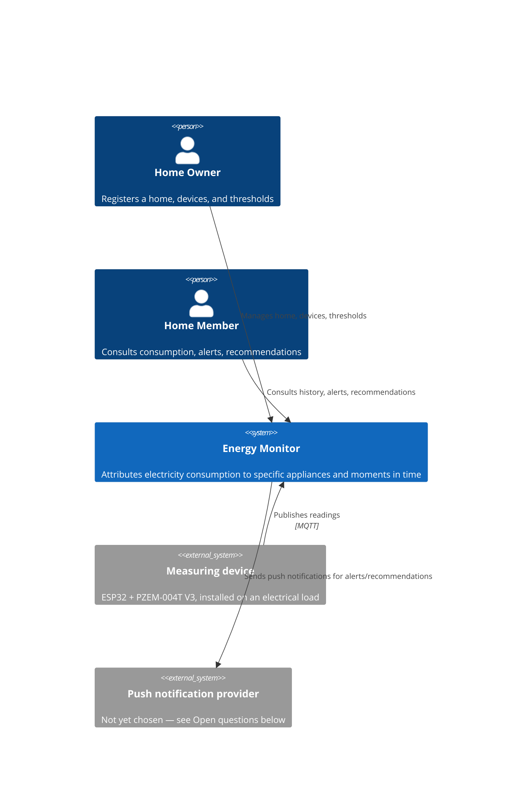
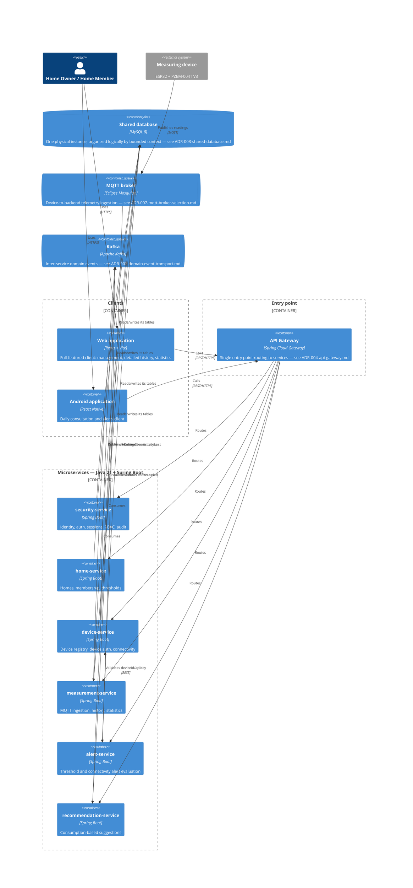

# System Architecture Overview

---

## Architecture diagram

### C4 Level 1 — System Context

### C4 Level 2 — Containers

> Both diagrams use C4-PlantUML/Mermaid `C4Context`/`C4Container` notation. If the Mermaid
> renderer used to view this repository does not support the C4 extension, the same information
> is in the tables below.

---

## Microservices

| Service                  | Responsibility                                                                              | Technology                                      | DB                                                            |
| ------------------------ | ------------------------------------------------------------------------------------------- | ----------------------------------------------- | ------------------------------------------------------------- |
| `security-service`       | Identity, authentication, sessions, RBAC, audit trail (`02-domain/domain-map.md`, Security) | Java 21 + Spring Boot, Spring Security + OAuth2 | Shared MySQL instance — Security tables (`06-data/models.md`) |
| `home-service`           | Homes, membership, home-scoped roles, thresholds (Home Management)                          | Java 21 + Spring Boot                           | Shared MySQL instance — Home Management tables                |
| `device-service`         | Device registry, device authentication (API key), connectivity tracking (Devices)           | Java 21 + Spring Boot                           | Shared MySQL instance — Devices tables                        |
| `measurement-service`    | MQTT ingestion, storage, consumption history and statistics (Monitoring and Measurements)   | Java 21 + Spring Boot                           | Shared MySQL instance — Monitoring and Measurements tables    |
| `alert-service`          | Threshold and connectivity alert evaluation and lifecycle (Alerts)                          | Java 21 + Spring Boot                           | Shared MySQL instance — Alerts tables                         |
| `recommendation-service` | Suggestions generated from a home's own measured consumption (Recommendations)              | Java 21 + Spring Boot                           | Shared MySQL instance — Recommendations tables                |

Each service has its own repository and its own Jenkins CI/CD pipeline (`01-context/overview.md`,
Technology stack). All six read and write only their own tables in the one shared MySQL instance
— see the access-boundary rule in `06-data/models.md`.

The two client applications are not microservices — they call the backend over the API Gateway,
not each other:

| Client             | Platform | Technology   |
| ------------------ | -------- | ------------ |
| Web application    | Browser  | React + Vite |
| Mobile application | Android  | React Native |

---

## Communication patterns

- **Sync (REST):**
  - `security-service` is an Open Host Service for the rest of the system: every other service
    validates the caller's identity from access-token claims issued by `security-service`, over
    REST (`02-domain/domain-map.md`, relationships table).
  - `home-service` → `device-service`, `alert-service`, `recommendation-service`: `homeId` passed
    and looked up as a foreign reference over REST, never a shared entity or a database join.
  - `device-service` → `recommendation-service`: same pattern with `deviceId`.
  - `measurement-service` → `device-service`: validates `deviceId` against its `apiKey` before
    accepting a published measurement.

- **Async (Kafka — domain events between services, per `ADR-002-domain-event-transport.md`):**
  - `measurement-service` publishes `MeasurementRecorded` (topic `monitoring.measurement-recorded`),
    consumed by `alert-service` and `recommendation-service`.
  - `device-service` publishes `DeviceConnectivityLost` (topic `devices.device-connectivity-lost`),
    consumed by `alert-service`.
  - Full event contracts: `02-domain/domain-events.md`.

- **Device ingestion (MQTT — separate channel, not Kafka):** measuring devices (ESP32 +
  PZEM-004T V3) publish readings to `measurement-service` over MQTT. This is device-to-backend
  telemetry, not a domain event between services — see the distinction documented in
  `02-domain/domain-events.md`. The broker itself is **not yet selected**; only the measuring
  hardware is currently in hand (`01-context/scope.md`, feature #11).

- **Gateway:** Spring Cloud Gateway, per `ADR-004-api-gateway.md`. Both clients call it as their
  single entry point; it routes to the six backend services and verifies each request's access
  token per `ADR-005-authentication-strategy.md`, instead of every service duplicating that check.

---

## Open questions

These are gaps found while writing this document, not decisions made here:

| Question                                                                                               | Where it should be resolved                                                                                         |
| ------------------------------------------------------------------------------------------------------ | ------------------------------------------------------------------------------------------------------------------- |
| Which push notification provider delivers alerts/recommendations (`01-context/scope.md`, feature #15)? | Not yet assigned a document — likely a new ADR if the choice is hard to reverse, or `cross-cutting.md` if it is not |

---

## Correlations

- Bounded contexts and inter-context relationships (source for this document's communication
  patterns) → `02-domain/domain-map.md`
- Domain events referenced above → `02-domain/domain-events.md`
- Full stack decisions and justifications → `01-context/overview.md`
- Shared-database decision → `ADR-003-shared-database.md` (`05-architecture/decisions/records/`)
- Kafka transport decision → `ADR-002-domain-event-transport.md` (`05-architecture/decisions/records/`)
- Table-level detail per service → `06-data/models.md`
- How this is actually deployed → `05-architecture/deployment.md`