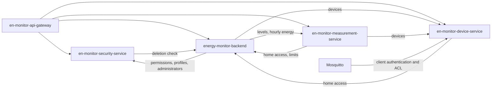
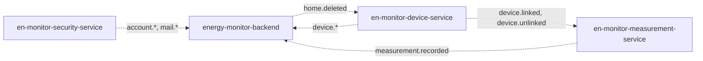

# Service Dependency Map

> Which service depends on which, as deployed in production on 24-Oct-2026. The calls themselves
> (endpoints, payloads, caches) are listed in `service-catalog.md` ("Service communication
> matrix"); this document shows the shape of the dependencies and what happens when one fails.

---

## Synchronous dependencies (REST)

A solid arrow means "calls at request time and needs the answer".

---

## Asynchronous dependencies (RabbitMQ)

A dotted arrow means "consumes the producer's events"; the producer does not wait for the
consumer, and its messages wait in its outbox while the consumer is down.

---

## Cycles

The synchronous graph has three two-way pairs: backend ↔ security, backend ↔ device and
backend ↔ measurement. They exist because the backend still owns Homes, which every extracted
service needs to authorize a request, while the backend's own modules read users, devices and
energy from the extracted services. They are known and accepted while the migration is in
progress (`05-architecture/decisions/records/ADR-013-modular-monolith-incremental-extraction.md`):

- no call in a pair is made while answering the other one, so a request never loops;
- every caller uses short timeouts and answers 503 instead of waiting, and the reads that are safe
  to cache keep a stale copy;
- they are reviewed again when Home, Alerts, Recommendations and Notification leave the backend
  (in progress, carried out by the teammate).

---

## When a service is down

| Service down | Effect | Recovers |
|---|---|---|
| `en-monitor-security-service` | No sign-in or refresh; backend routes that need permissions or profiles answer 503 once their cache expires | Account events wait in `security_outbox` |
| `en-monitor-device-service` | Device routes 503; new MQTT logins refused (connected modules keep publishing while the broker's cached decisions last, 5 min); readings of unknown devices dropped once caches expire | `device.*` events wait in `device_outbox` |
| `en-monitor-measurement-service` | Measurement and consumption routes 503; readings are not stored | Threshold alerts resume with the next readings; levels are served from the backend's cache (up to 24 h) |
| `energy-monitor-backend` | Home, alert, recommendation and notification routes 503; device and measurement services answer 503 where they need home access | `home.deleted` waits in `home_outbox`; consumed events wait in the backend's queues |
| RabbitMQ | Health of every producer DOWN; no event delivered | Every outbox keeps its messages and publishes them in order when the broker returns |

---

## Correlations

- Communication matrix and data ownership → `service-catalog.md`
- Internal API rules → `05-architecture/decisions/records/ADR-012-internal-service-api.md`
- Events → `05-architecture/decisions/records/ADR-008-rabbitmq-transactional-outbox.md`
- Per-service operation → `services/[service]/runbook.md`
