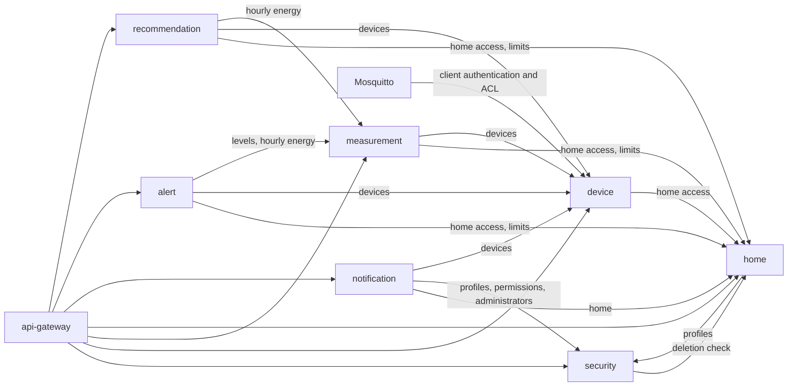
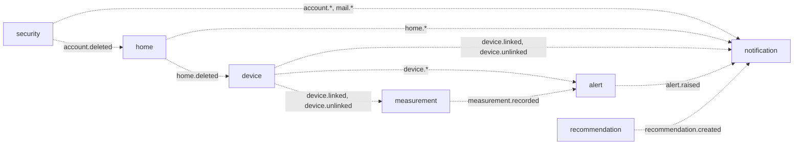

# Service Dependency Map

> Which service depends on which, as deployed in production since 28-Oct-2026. The calls themselves
> (endpoints, payloads, caches) are listed in `service-catalog.md` ("Service communication
> matrix"); this document shows the shape of the dependencies and what happens when one fails.

---

## Synchronous dependencies (REST)

A solid arrow means "calls at request time and needs the answer".

---

## Asynchronous dependencies (RabbitMQ)

A dotted arrow means "consumes the producer's events"; the producer does not wait for the
consumer, and its messages wait in its outbox while the consumer is down.

---

## Cycles

The synchronous graph has one two-way pair: **security ↔ home**. The security service asks the
home service whether an account may be deleted, and the home service asks the security service for
the names of the members. They are known and accepted:

- no call in the pair is made while answering the other one, so a request never loops;
- every caller uses short timeouts and answers 503 instead of waiting, and the reads that are safe
  to cache keep a stale copy;
- the cycle that existed while the migration was in progress (the backend with every other
  service) disappeared when the monolith was retired
  (`05-architecture/decisions/records/ADR-013-modular-monolith-incremental-extraction.md`).

The asynchronous graph has no cycles.

---

## When a service is down

| Service down | Effect | Recovers |
|---|---|---|
| `en-monitor-security-service` | No sign-in or refresh; home and notification calls that need names or permissions answer 503 once their cache expires | Account events wait in `security_outbox` |
| `en-monitor-device-service` | Device routes 503; new MQTT logins refused (connected modules keep publishing while the broker's cached decisions last, 5 min); readings of unknown devices dropped once caches expire | `device.*` events wait in `device_outbox` |
| `en-monitor-measurement-service` | Measurement and consumption routes 503; readings are not stored | Alerts resume with the next readings; levels are served from the callers' cache |
| `en-monitor-home-service` | Home routes 503; device, measurement, alert and recommendation routes answer 503 where they need home access; account deletion is refused | `home.*` events wait in `home_outbox`; `account.deleted` waits in the home queue |
| `en-monitor-notification-service` | No e-mail codes, no alert or recommendation delivery; inbox 503 | The events wait in the notification queues |
| `en-monitor-alert-service` | No alerts are raised; alert routes 503 | `measurement.recorded` and `device.*` wait in the alert queues |
| `en-monitor-recommendation-service` | No new recommendations; routes 503 | The next hourly evaluation catches up |
| RabbitMQ | Health of every producer DOWN; no event delivered | Every outbox keeps its messages and publishes them in order when the broker returns |

---

## Correlations

- Communication matrix and data ownership → `service-catalog.md`
- Internal API rules → `05-architecture/decisions/records/ADR-012-internal-service-api.md`
- Events → `05-architecture/decisions/records/ADR-008-rabbitmq-transactional-outbox.md`
- Per-service operation → `services/[service]/runbook.md`
