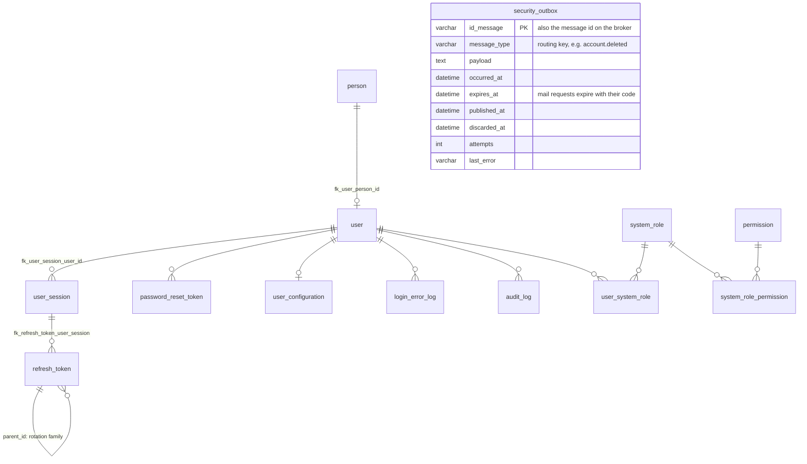

# Data Model — Security Service

> `en-monitor-security-service` is the **authoritative owner** of the tables below. No other
> service reads them directly: the backend asks for permissions, profiles and administrators
> through the internal API, and hears account changes as events.

---

## Database engine

**Engine:** MySQL 8.4, the one shared schema `energy_monitor` (`ADR-003-shared-database.md`).

**Justification:** a platform decision — one instance for the whole system, each service owning
its own tables, no foreign key across services.

---

## Tables

Column-level detail of every table except the outbox is in `06-data/models.md` (Bounded Context:
Security).

| Table | Purpose |
|---|---|
| `person` | Personal data (name, last name, profile image) |
| `user` | Account: e-mail, password hash, status, Google subject, soft delete |
| `user_configuration` | Per-user notification and interface preferences |
| `user_session` | Persisted, revocable session |
| `refresh_token` | Hashed refresh tokens; `parent_id` links the rotation family for reuse detection |
| `password_reset_token` | Recovery codes (peppered HMAC), attempts |
| `password_policy`, `security_configuration` | Password rules and system-wide security settings |
| `login_error_log` | Failed sign-ins and their error type (including `EMAIL_NOT_VERIFIED`) |
| `system_role`, `permission`, `system_role_permission`, `user_system_role` | Global RBAC (`ADMIN` seeded by `security-025`) |
| `audit_log` | Who did what, when, from where |
| `security_outbox` | Transactional outbox of account events and mail requests (`security-026`) |

---

## Modeling decisions

- **Outbox in the service's own tables:** the message row is written in the same transaction as
  the change (`ADR-008`).
- **Mail requests carry a code in clear text:** the payload is erased as soon as the broker
  confirms it, and `expires_at` lets the relay discard it unsent once the code is no longer valid.
- **Deleted accounts release their address:** the deleted row keeps
  `deleted+<id_user>@deleted.invalid`, so the same address can register again.

---

## Schema migration

**Tool:** Liquibase, applied by the service on startup (`ADR-009`).
**Script location:** `src/main/resources/db/changelog/security/` (same relative path as in the
monolith, so already-applied changesets are recognised).
**Naming convention:** `security-NNN-description` (`security-001` … `security-027` on 24-Oct-2026).

**Rollback policy:** every changeset has a `rollback` block; changes are forward-only in
production (`06-data/migration-strategy.md`).
