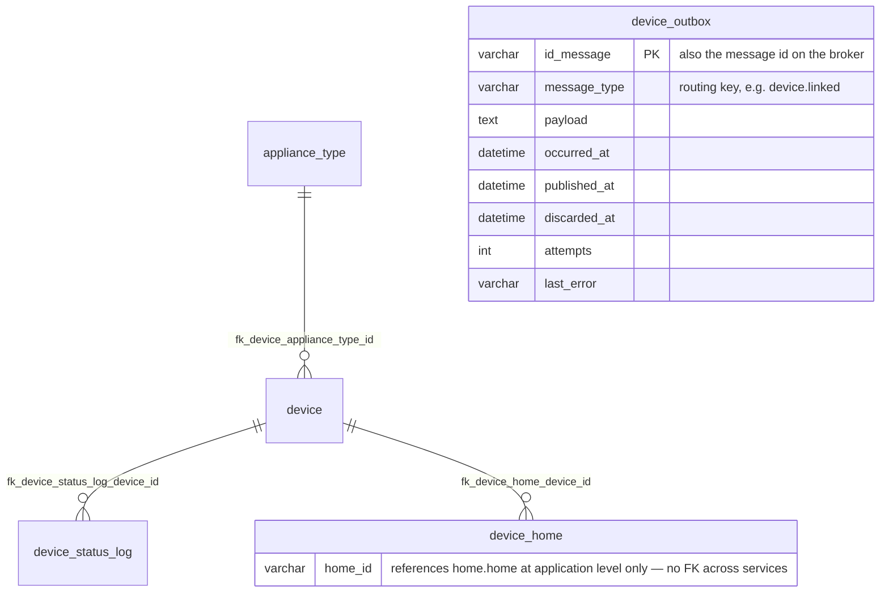

# Data Model — Device Service

> `en-monitor-device-service` is the **authoritative owner** of the tables below. Other services
> read devices through its internal API (`GET /internal/devices/{id}`,
> `GET /internal/homes/{homeId}/devices`) and hear changes as events, never from these tables.

---

## Database engine

**Engine:** MySQL 8.4, the one shared schema `energy_monitor` (`ADR-003-shared-database.md`).

**Justification:** a platform decision — one instance for the whole system, each service owning
its own tables, no foreign key across services.

---

## Schema

Column-level detail of `appliance_type`, `device`, `device_status_log` and `device_home` is in
`06-data/models.md` (Bounded Context: Devices).

| Table | Purpose |
|---|---|
| `appliance_type` | Appliance catalogue (seeded by `device-006`) |
| `device` | A measuring module: name, appliance type, location, description, installation date, `device_code`, API key **hash** (`device-007`; the clear key column was dropped by `device-008`) |
| `device_home` | Link of a device to a home (`home_id`) |
| `device_status_log` | Connectivity history: `status`, `last_seen`, `signal_strength`; a new row for each retained `online`/`offline` status |
| `device_outbox` | Transactional outbox of the device events (`device-009`) |

### Indexes

| Name | Fields | Justification |
|------|--------|---------------|
| `idx_device_outbox_pending` | `published_at`, `discarded_at`, `occurred_at` | The relay reads the pending messages in order |

---

## Modeling decisions

- **`home_id` without a foreign key:** homes belong to the home service; a device refers to
  its home by identifier only.
- **API key as a hash:** the key is shown once when the module is linked (or reissued) and only its
  SHA-256 hash is stored.

---

## Schema migration

**Tool:** Liquibase, applied by the service on startup (`ADR-009`).
**Script location:** `src/main/resources/db/changelog/device/` — `device-001` to `device-008` keep
the path they had in the retired monolith, so they were recognised as applied; only
`device-009` (`device_outbox`) ran when the service was first deployed.
**Naming convention:** `device-NNN-description`.

**Rollback policy:** every changeset has a `rollback` block; forward-only in production.
