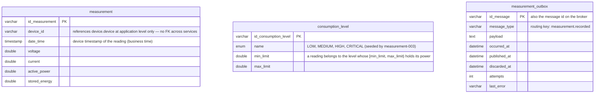

# Data Model — Measurement Service

> `en-monitor-measurement-service` is the **authoritative owner** of the tables below. The backend
> reads levels and hourly energy through the internal API and hears every reading as
> `measurement.recorded`; no other service reads these tables.

---

## Database engine

**Engine:** MySQL 8.4, the one shared schema `energy_monitor` (`ADR-003-shared-database.md`).

**Justification:** a platform decision — one instance for the whole system, each service owning
its own tables, no foreign key across services.

---

## Schema

Column-level detail of `measurement` and `consumption_level` is in `06-data/models.md` (Bounded
Context: Monitoring and Measurements).

| Table | Purpose |
|---|---|
| `measurement` | One row per stored reading (`measurement-001`) |
| `consumption_level` | Level catalogue (`measurement-002`, seeded by `measurement-003`) |
| `measurement_outbox` | Transactional outbox of `measurement.recorded` (`measurement-004`) |

### Indexes

| Name | Fields | Justification |
|------|--------|---------------|
| `idx_measurement_outbox_pending` | `published_at`, `discarded_at`, `occurred_at` | The relay reads the pending messages in order |
| `idx_measurement_outbox_discarded` | `discarded_at` | The purge removes discarded messages by age |

---

## Modeling decisions

- **One outbox row per reading, purged:** published and discarded rows are purged after 7 days
  (`messaging.retention`), every hour; pending rows are never purged.
- **`device_id` without a foreign key:** devices belong to the device service.
- **The history did not move:** the readings stayed in the same `measurement` table when the
  service took over.

---

## Schema migration

**Tool:** Liquibase, applied by the service on startup (`ADR-009`).
**Script location:** `src/main/resources/db/changelog/measurement/` — `measurement-001` to
`measurement-003` keep the path they had in `energy-monitor-backend` and were recognised as
applied; `measurement-004` (`measurement_outbox`) is the new changeset.
**Naming convention:** `measurement-NNN-description`.

**Rollback policy:** every changeset has a `rollback` block; forward-only in production.
