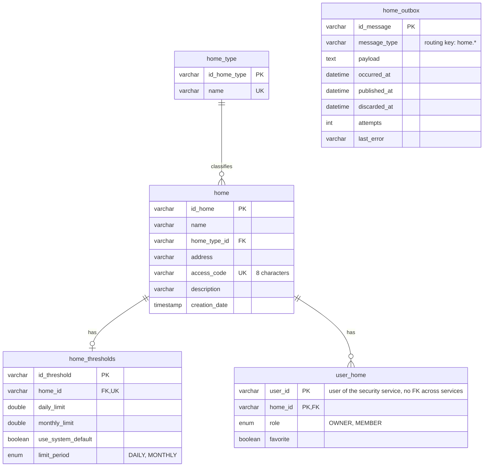

# Data Model — Home Service

> `en-monitor-home-service` is the **authoritative owner** of the tables below. Other services
> read them only through its internal API or its `home.*` events.

---

## Database engine

**Engine:** MySQL 8.4, the one shared schema `energy_monitor` (`ADR-003-shared-database.md`).

---

## Schema

Column-level detail is in `06-data/models.md` and `06-data/data-dictionary.md` (Bounded Context:
Home Management).

| Table | Purpose |
|---|---|
| `home_type` | Home type catalogue (`home-001`, seeded by `home-005`) |
| `home` | Homes (`home-002`) |
| `home_thresholds` | Consumption limits per home (`home-003`, `home-006` adds `limit_period`) |
| `user_home` | Memberships: role and favourite (`home-004`) |
| `home_outbox` | Transactional outbox of the `home.*` events (`home-007`) |

---

## Modeling decisions

- **`user_id` without a foreign key:** users belong to the security service.
- **Soft delete:** every table has `deleted_at`; deleting a home soft-deletes `home`, `user_home` and
  `home_thresholds` and writes `home.deleted` in the same transaction.
- **Ownership transfer** swaps the two `user_home.role` values in one transaction, so a home
  never has zero or two owners.

---

## Schema migration

**Tool:** Liquibase, applied by the service on startup (`ADR-009`).
**Script location:** `src/main/resources/db/changelog/home/changes/` — `home-001` to `home-006` keep
the path they had in the retired monolith; `home-007` (`home_outbox`) is the new changeset.
**Naming convention:** `home-NNN-description`.

**Rollback policy:** every changeset has a `rollback` block; forward-only in production.
