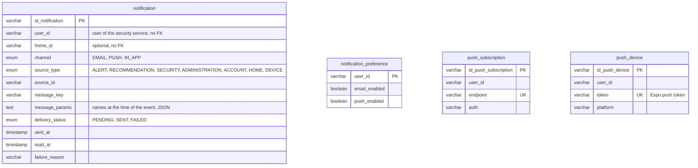

# Data Model — Notification Service

> `en-monitor-notification-service` is the **authoritative owner** of the tables below. No other
> service reads them.

---

## Database engine

**Engine:** MySQL 8.4, the one shared schema `energy_monitor` (`ADR-003-shared-database.md`).

---

## Schema

Column-level detail is in `06-data/models.md` and `06-data/data-dictionary.md` (Bounded Context:
Notification).

| Table | Purpose |
|---|---|
| `notification` | Delivery log and in-app inbox (`notification-001`, `-004`, `-006`, `-007`) |
| `notification_preference` | E-mail and push preferences per user (`notification-002`) |
| `push_subscription` | Browser push subscriptions (`notification-003`) |
| `push_device` | Mobile app installations (`notification-005`) |

This service has **no outbox**: it only consumes events.

---

## Modeling decisions

- **No foreign keys:** users and homes belong to other services.
- **`message_params`:** the notification stores the names (home, device, people) at the time of
  the event; the client translates `message_key` with them, so renaming a home later does not
  rewrite history.
- **Soft delete:** every table has `deleted_at`; the data of a deleted account is cleaned up from
  `account.deleted`.

---

## Schema migration

**Tool:** Liquibase, applied by the service on startup (`ADR-009`).
**Script location:** `src/main/resources/db/changelog/notification/changes/` — `notification-001` to
`notification-007`.
**Naming convention:** `notification-NNN-description`.

**Rollback policy:** every changeset has a `rollback` block; forward-only in production.
