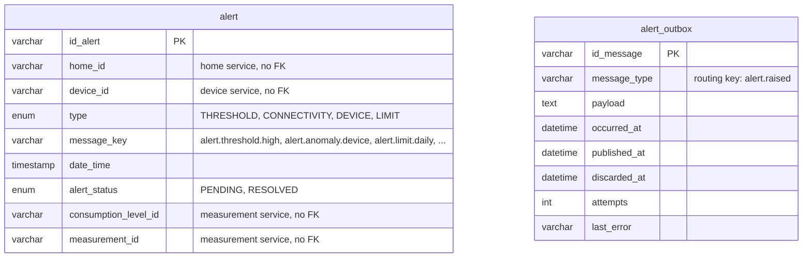

# Data Model — Alert Service

> `en-monitor-alert-service` is the **authoritative owner** of the tables below. The notification
> service hears `alert.raised`; no other service reads them.

---

## Database engine

**Engine:** MySQL 8.4, the one shared schema `energy_monitor` (`ADR-003-shared-database.md`).

---

## Schema

Column-level detail is in `06-data/models.md` and `06-data/data-dictionary.md` (Bounded Context:
Alerts).

| Table | Purpose |
|---|---|
| `alert` | Alerts of every home (`alert-001`; `alert-002` adds `DEVICE`, `alert-003` adds `LIMIT`) |
| `alert_outbox` | Transactional outbox of `alert.raised` (`alert-004`) |

---

## Modeling decisions

- **The unusual-consumption alert is a `THRESHOLD`:** it has no type of its own; it is
  distinguished by `message_key = alert.anomaly.device`, so clients and the database did not need
  a new enum value.
- **No foreign keys:** homes, devices, levels and measurements belong to other services.
- **`PENDING` / `RESOLVED`:** system alerts resolve themselves; reading one marks it `RESOLVED`
  only where that is allowed.

---

## Schema migration

**Tool:** Liquibase, applied by the service on startup (`ADR-009`).
**Script location:** `src/main/resources/db/changelog/alert/changes/` — `alert-001` to `alert-003`
keep the path they had in the retired monolith; `alert-004` (`alert_outbox`) is the new changeset.
**Naming convention:** `alert-NNN-description`.

**Rollback policy:** every changeset has a `rollback` block; forward-only in production.
