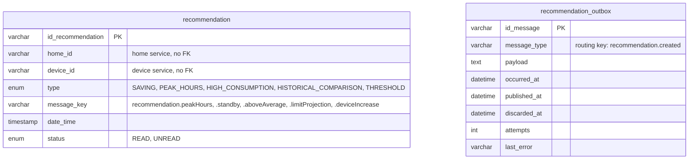

# Data Model — Recommendation Service

> `en-monitor-recommendation-service` is the **authoritative owner** of the tables below. The
> notification service hears `recommendation.created`; no other service reads them.

---

## Database engine

**Engine:** MySQL 8.4, the one shared schema `energy_monitor` (`ADR-003-shared-database.md`).

---

## Schema

Column-level detail is in `06-data/models.md` and `06-data/data-dictionary.md` (Bounded Context:
Recommendations).

| Table | Purpose |
|---|---|
| `recommendation` | Recommendations of every home (`recommendation-001`) |
| `recommendation_outbox` | Transactional outbox of `recommendation.created` (`recommendation-002`) |

---

## Modeling decisions

- **No foreign keys:** homes and devices belong to other services.
- **`message_key`, not text:** the client translates the key, so the stored row is language-free.
- **Only read recommendations can be deleted** (409 otherwise), so nobody loses unseen advice.

---

## Schema migration

**Tool:** Liquibase, applied by the service on startup (`ADR-009`).
**Script location:** `src/main/resources/db/changelog/recommendation/changes/` —
`recommendation-001` keeps the path it had in the retired monolith; `recommendation-002`
(`recommendation_outbox`) is the new changeset.
**Naming convention:** `recommendation-NNN-description`.

**Rollback policy:** every changeset has a `rollback` block; forward-only in production.
